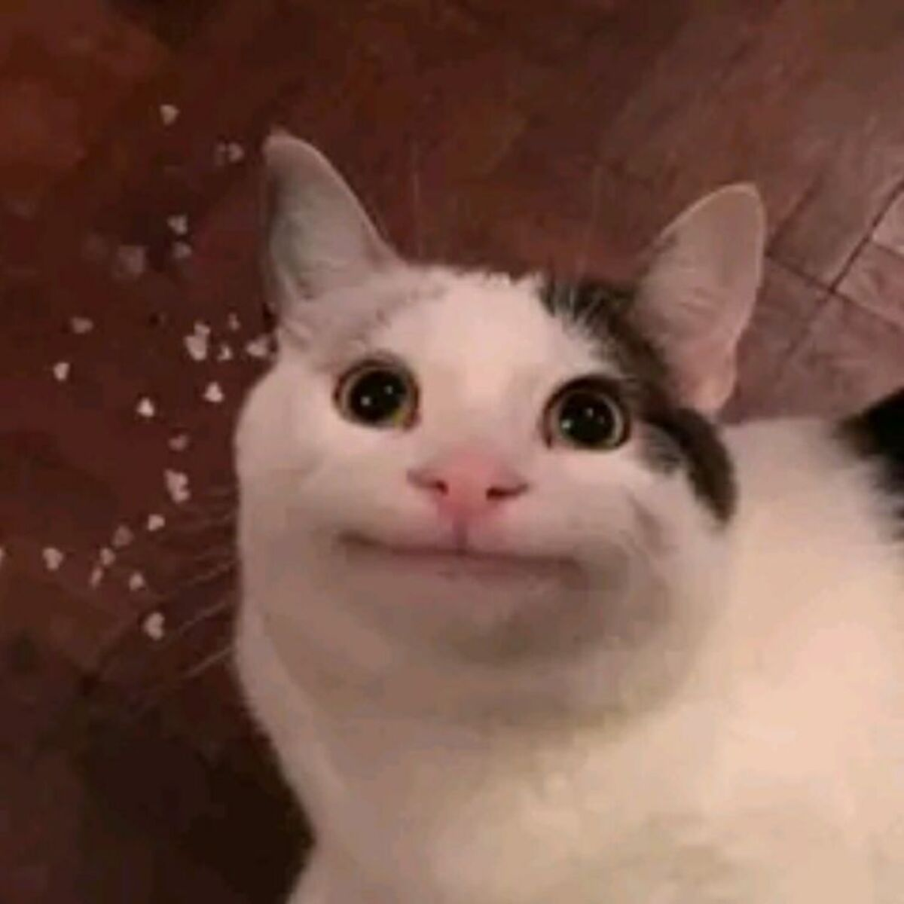

# Hi there 👋

I'm Muhamad Firman Hakim, a third-year student from the department of Software Engineering. I'm taking the Software Management and Evolution course this semester.
I expect to learn a lot about how modern software is maintained and improved after its initial development, common practices and how to work with legacy systems.

- **Fun fact**: I have a cat.
- **Course expectations**: To learn more about post-development workflows as well as familiarize myself with collaborative workflows in preparation for the industry.

